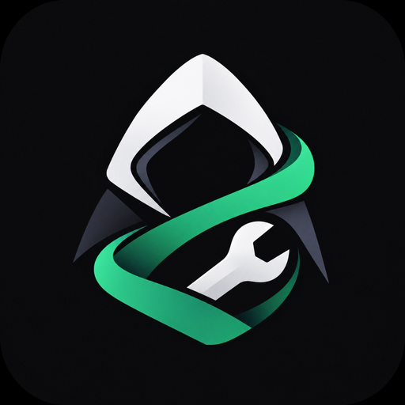

<div align="center">



# 🛡️ Anonymous-Tools

### *The Stealthiest, Offline-First Privacy Capture Suite for Android*

[](https://android.com)
[-007ACC?style=for-the-badge&logo=android&logoColor=white)](https://developer.android.com)
[](https://kotlinlang.org)
[](https://developer.android.com/jetpack/compose)
[](LICENSE)
[](https://github.com/anonymousagyat/Anonymous-Tools)

<br/>

**Zero shutter sounds.** **Zero system recording dialogs.** **Zero public gallery leakage.**  
*Engineered from the ground up for discreet, offline, and secure screen capture on modern Android devices.*

---

</div>

## ✨ Key Highlights

- 📸 **Hardware Key Instant Trigger**: Press **Volume Up + Volume Down** simultaneously to snap a silent screenshot from anywhere, anytime.
- 🎥 **Stealth Sequential Video Engine**: Pushes continuous raw buffer captures at **~3.5 FPS** (the Android hardware limit) and compiles them into a smooth H.264 `.mp4` video with dynamic real-time playback.
- 🔕 **Undetectable Screen Capture**: Bypasses Android 14 `ScreenCaptureCallback` and Google casting dialogs entirely. No status bar recording chips, no black box artifacts.
- ⚡ **1-Tap Quick Settings Tile**: Start and stop capture directly from your system quick settings panel. No floating bubble or on-screen overlay needed.
- 🔐 **Isolated Private Vault**: All snapshots and videos are strictly stored in app-private storage behind a `.nomedia` sentinel guard—completely invisible to Google Photos and public gallery apps.
- 🎨 **Pastel Neo-Brutalist Design**: Clean, high-contrast, utilitarian UI built with Jetpack Compose, featuring warm cream backdrops and soft pastel accents.

---

## 🔍 Deep Dive: How It Works

### 1. 📸 Hardware Trigger (Volume Up + Down)
> No need to touch the screen or reveal your app is running.
- Intercepts raw key events using `AccessibilityService.FLAG_REQUEST_FILTER_KEY_EVENTS`.
- Pressing both **Volume Up** and **Volume Down** simultaneously triggers an instant snapshot.
- If a screen recording session is currently running, pressing the hardware combo immediately stops recording and saves the video directly to your private vault.
- Delivers a subtle haptic pulse confirmation with zero shutter sounds.

### 2. 🎥 Sequential Screenshot-to-Video Engine
> Why traditional MediaProjection fails: standard recorders trigger casting prompts, are detected by third-party apps, and produce solid black boxes over secure windows.
- **Asynchronous Disk I/O**: Frame capture and JPEG compression are offloaded onto background `Dispatchers.IO` threads, bringing capture thread blocking latency down to **0ms**.
- **Maximized Hardware Rate**: Employs an adaptive 25ms – 35ms cooldown loop to capture frames at the physical hardware buffer limit (**~3.0 to 3.5 FPS**).
- **Dynamic 1:1 Real-Time Playback**: The video encoder calculates the exact elapsed time upon recording termination and dynamically sets the container framerate, guaranteeing natural, 1:1 playback pacing.
- **Hardware-Accelerated Compilation**: Uses Android's native `MediaCodec` and `MediaMuxer` to render bitmaps directly to an input Surface and encode an optimized H.264 MP4 file.

### 3. ⚡ Quick Settings Tile (1-Tap Control)
- Pull down your notification shade and tap the **Anonymous-Tools** tile.
- **Single Tap to Record**: Begins sequential capture with a double-vibration pulse.
- **Single Tap to Stop**: Tapping the tile while active immediately compiles and saves the video to the vault with a single confirmation pulse.
- Runs in pure stealth mode without drawing any overlay windows or controller bars on top of other apps.

### 4. 🔐 Isolated Private Vault
- Files are saved in internal private storage: `context.filesDir/vault/`.
- Hidden from third-party media indexers via `.nomedia` protection.
- In-vault features:
  - 🖼️ Fast asynchronous thumbnail caching.
  - 🔍 Fullscreen pinch-to-zoom image viewer.
  - 📤 One-tap export to public gallery (Pictures/Movies).
  - 🗑️ Instant shredder to securely purge all vault captures.

---

## 📊 Comparison Matrix

| Feature | Standard Screen Recorders | Anonymous-Tools |
| :--- | :---: | :---: |
| **System Casting Dialog** | ⚠️ Always Shows Prompt | 🛡️ **Completely Bypassed** |
| **Status Bar Recording Chip** | 🔴 Persistent Red Dot | 🔕 **Zero Notification Giveaway** |
| **App Detection (Android 14)** | ❌ Detected via API | 🛡️ **Undetectable Buffer Capture** |
| **Hardware Key Shortcut** | ❌ None | ⚡ **Volume Up + Down** |
| **Black Box Window Occlusion** | ❌ Produces Black Boxes | 🛡️ **Zero Occlusion** |
| **Storage Security** | 📂 Public Android MediaStore | 🔐 **Isolated Private Vault (`.nomedia`)** |
| **Network & Telemetry** | 📡 Often Tracks Analytics | 📴 **100% Offline (No Internet Permission)** |

---

## 🎨 Pastel Neo-Brutalist Design System

Inspired by retro-modern utilitarianism, the user interface balances bold geometric structures with soft pastel accents:

| Token | Hex | Visual Purpose |
| :--- | :---: | :--- |
| **Cream Surface** | `#F6F0DF` | Primary app background |
| **Text & Borders** | `#111111` | High-contrast 1.5dp borders & heavy typography |
| **Mint Green** | `#B4F0CE` | Active services, vault security badges |
| **Peach** | `#FFAE88` | Video captures, warnings, secondary action cards |
| **Powder Blue** | `#A9C8E5` | Overlay permission indicators, system metrics |
| **Lavender** | `#B9A4E8` | Hardware shortcut cards, interactive actions |
| **Golden Yellow** | `#E9B945` | File count indicators & storage trackers |

---

## 🛠️ Architecture & Tech Stack

```
com.anonymoustools.app/
├── core/
│   ├── capture/       # FrameVideoEncoder (MediaCodec + MediaMuxer)
│   ├── crypto/        # Encrypted file management & storage
│   └── vault/         # PrivateVaultManager (.nomedia guard)
├── service/
│   ├── gesture/       # GestureAccessibilityService (Hardware keys & frame loop)
│   ├── overlay/       # Stealth overlay controllers
│   └── tile/          # StealthTileService (Quick Settings Tile)
├── features/
│   ├── home/          # CaptureCenterScreen (Utilitarian dashboard)
│   └── vault/         # VaultGalleryScreen (Thumbnail grid & fullscreen viewer)
└── ui/
    └── theme/         # Pastel Neo-Brutalist design tokens & typography
```

- **Language**: Kotlin 2.0
- **UI Toolkit**: Jetpack Compose (Material 3)
- **Async Runtime**: Kotlin Coroutines & Flows
- **Encoding Pipeline**: Android Hardware `MediaCodec` + `MediaMuxer`
- **Target OS**: Android 14 (API 34) | **Min OS**: Android 8.0 (API 26)

---

## 🚀 Building & Installing

### Prerequisites
- Android Studio Ladybug / Iguana or later
- JDK 17 (set in `JAVA_HOME`)
- Android SDK Platform 34

### 1. Build via Command Line (PowerShell)
```powershell
# Set JDK 17
$env:JAVA_HOME = "C:\Program Files\Android\Android Studio\jbr"

# Build Debug APK
.\gradlew assembleDebug
```
The output APK is generated at:
```
app/build/outputs/apk/debug/app-debug.apk
```

### 2. Install to Connected Device via ADB
```powershell
adb install -r app/build/outputs/apk/debug/app-debug.apk
```

---

## 📄 License

This project is licensed under the [MIT License](LICENSE) - feel free to use, modify, and distribute.

<br/>

<div align="center">
<b>Built for privacy. Designed with precision.</b>
</div>
